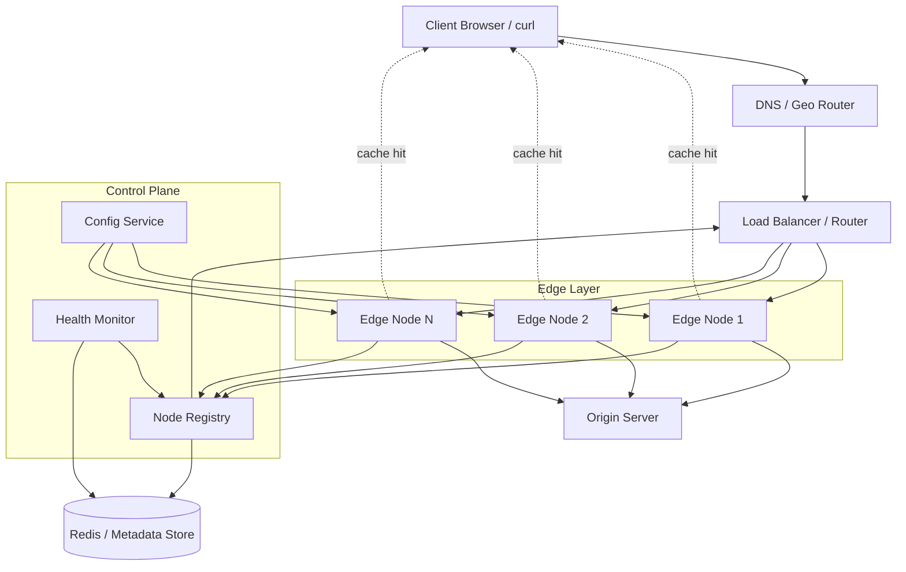

# MiniCDN — prototype and project plan

Current implementation and submission evidence (10 October 2026): [SRS and UML](docs/academic/design-and-srs.md), [five-paper review](docs/academic/research-review.md), [evaluation schedule and completion ledger](docs/academic/submission-plan.md), [routing comparison data](docs/academic/results/routing-comparison.csv), and [deployment guide](docs/hosting.md). The tested core includes three routing policies, bounded memory LRU, coalescing, conditional revalidation and missed-purge recovery. Disk caching and public hosting remain open.

Current code review, research-gap explanations and provisional research phases: [research roadmap](docs/research-roadmap.md). The first cache-fill coordination increment passes the Go 1.21 container test suite, race detector and repeated cold-burst regression. The blueprint checkboxes below do not represent audited implementation status.

A greenfield project: distributed content delivery with intelligent caching and load balancing. Below is a complete blueprint you can build from.

For installed tool versions and repeatable test commands, see [local development](docs/development.md).

For the team explanation of the USP, project motivation, changes and dashboard panels, see the [printable group brief](docs/MiniCDN-Group-Brief.html) and the newer academic reports. Run `node scripts/metrics-demo.mjs` to generate bounded local activity for the 13-panel Grafana dashboard at http://localhost:3000/d/minicdn-dashboard. The dashboard demo is not a load benchmark.

---

## 1. Vision & Goals

**What it is:** A small-scale CDN that sits between clients and an origin server, serving static assets (images, JS, CSS, HTML, video) from geographically or logically distributed edge nodes.

**Primary goals:**
- Reduce latency by serving content from the nearest healthy node
- Cut origin load via multi-tier caching
- Scale horizontally by adding edge nodes
- Demonstrate real CDN concepts: cache invalidation, TTL, health checks, consistent routing

**Non-goals (v1):**
- Full TLS termination at scale
- Video streaming (HLS/DASH)
- Global anycast / BGP
- Multi-tenant billing

---

## 2. High-Level Architecture



**Three planes:**

| Plane | Role |
|-------|------|
| **Data** | Edge nodes fetch, cache, and serve content |
| **Control** | Registry, health checks, config, cache policies |
| **Routing** | Pick the best edge node per request |

---

## 3. Core Components

### 3.1 Origin Server
- Simple HTTP file server (Node/Go/Python)
- Serves files from disk or S3-compatible storage
- Sets cache headers: `Cache-Control`, `ETag`, `Last-Modified`
- Optional: webhook to notify CDN on content update

### 3.2 Edge Node
Each edge node is an independent cache server:

```
Request → Router middleware → Cache lookup → [HIT: return] / [MISS: fetch origin → store → return]
```

**Responsibilities:**
- HTTP server (port 8080+)
- Local cache (memory L1 + disk L2)
- Pull from origin on cache miss
- Report metrics and heartbeats to control plane
- Honor TTL, stale-while-revalidate, purge commands

### 3.3 Load Balancer / Smart Router
Not just round-robin — **intelligent routing**:

| Strategy | When to use |
|----------|-------------|
| **Round Robin** | Baseline, equal nodes |
| **Least Connections** | Variable request duration |
| **Weighted** | Different node capacity |
| **Latency-based** | Pick lowest RTT node |
| **Geo / region** | `X-Region` or client IP → nearest node |
| **Consistent Hash** | Same URL → same node (better cache locality) |

**v1 recommendation:** Consistent hashing on URL + health-aware fallback.

### 3.4 Control Plane
- **Node Registry:** Register/deregister edges, store `{id, host, port, region, weight, status}`
- **Health Monitor:** Periodic `GET /health`; mark unhealthy after N failures
- **Config Service:** Global TTL defaults, max cache size, purge lists
- **Admin API:** Purge cache, list nodes, view stats

### 3.5 Client-Facing DNS (optional v2)
- Simple resolver that returns nearest healthy edge IP
- v1: clients hit the router directly

---

## 4. Intelligent Caching Design

### 4.1 Cache Hierarchy

```
L1: In-memory (LRU, hot objects, ~100MB)
L2: Disk (larger, ~1–10GB)
Origin: Source of truth
```

### 4.2 Cache Key
```
{method}:{host}:{path}?{sorted_query}
```
Normalize query params; optionally vary on `Accept-Encoding`.

### 4.3 Eviction Policies

| Policy | Use case |
|--------|----------|
| **LRU** | General default |
| **LFU** | Stable hot content |
| **TTL-based** | Respect `Cache-Control` |
| **Size-aware** | Evict large cold objects first |

**v1:** LRU + strict TTL from response headers.

### 4.4 Cache States

```
FRESH     → serve immediately
STALE     → serve + background revalidate (optional v2)
MISS      → fetch from origin
REVALIDATE → conditional GET with ETag/If-Modified-Since
```

### 4.5 Invalidation

| Method | Mechanism |
|--------|-----------|
| **TTL expiry** | Automatic |
| **Purge by URL** | Admin API → broadcast to all edges |
| **Purge by prefix** | e.g. `/assets/v2/*` |
| **Surrogate keys** | Tag objects, purge by tag (v2) |

### 4.6 Cache Intelligence (stretch)

- Track hit ratio per path
- Pre-warm popular URLs after deploy
- Adaptive TTL: extend TTL for high-hit, low-churn content
- Request coalescing: one origin fetch for concurrent misses on same key

---

## 5. Load Balancing & Failover

```
1. Client → Router
2. Router loads healthy nodes from Registry
3. Hash(url) → primary node
4. If primary unhealthy → next node in hash ring
5. Forward request (proxy) or redirect (302)
```

**Health check contract:**
```http
GET /health
→ 200 {"status":"ok","cache_size_mb":512,"hit_ratio":0.87}
```

**Failure modes:**

| Scenario | Behavior |
|----------|----------|
| Edge down | Skip in ring, route to next |
| Origin down | Serve stale if allowed; else 502 |
| Registry down | Edges use cached node list + local config |
| Split brain | Prefer origin; short TTL on errors |

---

## 6. Recommended Tech Stack

| Layer | Option A (simple) | Option B (production-ish) |
|-------|-------------------|---------------------------|
| Edge / Router | **Go** (fast, great HTTP) | Rust |
| Origin | Node.js Express | Go static file server |
| Registry | Redis + REST API | etcd / Consul |
| Metrics | Prometheus + Grafana | Same |
| Deploy | Docker Compose | Kubernetes |
| Storage | Local disk | MinIO (S3) as origin |

**Recommendation for learning + demo:** Go services + Redis + Docker Compose + Prometheus.

---

## 7. Repository Structure

```
mini-cdn/
├── README.md
├── docker-compose.yml
├── docs/
│   ├── architecture.md
│   ├── api.md
│   └── runbook.md
├── pkg/                          # shared Go libraries
│   ├── cache/
│   │   ├── lru.go
│   │   ├── disk.go
│   │   └── policy.go
│   ├── hash/
│   │   └── consistent.go
│   ├── httputil/
│   └── metrics/
├── cmd/
│   ├── origin/
│   │   └── main.go
│   ├── edge/
│   │   └── main.go
│   ├── router/
│   │   └── main.go
│   └── control/
│       └── main.go
├── web/
│   └── admin-dashboard/          # optional React UI
├── configs/
│   ├── origin.yaml
│   ├── edge.yaml
│   └── router.yaml
├── scripts/
│   ├── seed-content.sh
│   ├── load-test.sh
│   └── purge.sh
├── tests/
│   ├── integration/
│   └── e2e/
└── benchmarks/
    └── cache_bench_test.go
```

---

## 8. API Contracts

### Edge — serve content
```http
GET /cdn/*path
X-Cache: HIT | MISS | REVALIDATED
X-Edge-Node: edge-us-east-1
```

### Edge — health
```http
GET /health
```

### Control — register node
```http
POST /api/v1/nodes
{
  "id": "edge-1",
  "host": "10.0.0.5",
  "port": 8081,
  "region": "us-east",
  "weight": 100
}
```

### Control — purge
```http
POST /api/v1/purge
{
  "urls": ["/assets/logo.png"],
  "prefixes": ["/static/v1/"]
}
```

### Router — proxy
```http
GET /*  → forwards to selected edge
```

---

## 9. Data Models

### Node (Redis hash: `node:{id}`)
```json
{
  "id": "edge-1",
  "host": "edge-1",
  "port": 8081,
  "region": "us-east",
  "weight": 100,
  "status": "healthy",
  "last_seen": "2026-08-12T10:00:00Z",
  "metrics": {
    "hit_ratio": 0.85,
    "requests_total": 120000
  }
}
```

### Cache entry (local disk index)
```json
{
  "key": "GET:cdn.example.com:/img/a.png",
  "path": "/var/cache/ab/cd/...",
  "size_bytes": 4096,
  "etag": "\"abc123\"",
  "expires_at": "2026-08-13T10:00:00Z",
  "created_at": "2026-08-12T10:00:00Z"
}
```

---

## 10. Implementation Phases

### Phase 0 — Foundation (Week 1)
- [ ] Monorepo scaffold, Docker Compose
- [ ] Origin server with static files + cache headers
- [ ] Single edge node: proxy + in-memory cache
- [ ] Manual test: `curl` through edge

**Exit criteria:** Cache HIT/MISS headers work for one edge.

### Phase 1 — Multi-node + routing (Week 2)
- [ ] Consistent hash router
- [ ] 3 edge containers in Compose
- [ ] Node registration on startup
- [ ] Health checks + unhealthy node exclusion

**Exit criteria:** Adding/removing a node changes routing; dead node is skipped.

### Phase 2 — Disk cache + TTL (Week 3)
- [ ] L2 disk cache with LRU eviction
- [ ] Parse `Cache-Control`, `ETag`, `Last-Modified`
- [ ] Conditional revalidation
- [ ] Configurable max cache size

**Exit criteria:** Restart edge → disk cache survives; TTL respected.

### Phase 3 — Control plane (Week 4)
- [ ] Redis-backed registry
- [ ] Control API (nodes, purge, config)
- [ ] Purge propagation to all edges
- [ ] Basic Prometheus metrics

**Exit criteria:** Purge URL → next request is MISS on all edges.

### Phase 4 — Intelligence & polish (Week 5)
- [ ] Latency-based routing (optional)
- [ ] Request coalescing on miss
- [ ] Load test script + dashboard
- [ ] Admin UI (optional)
- [ ] README + architecture docs

**Exit criteria:** Load test shows >80% hit ratio on repeated assets; failover demo works.

### Phase 5 — Stretch goals
- [ ] Stale-while-revalidate
- [ ] Surrogate key purging
- [ ] Pre-warming script
- [ ] Geo DNS simulator
- [ ] Kubernetes manifests

---

## 11. Local Dev Setup (Docker Compose)

```yaml
services:
  origin:
    build: ./cmd/origin
    ports: ["9000:9000"]
    volumes: ["./sample-content:/data"]

  redis:
    image: redis:7-alpine
    ports: ["6379:6379"]

  control:
    build: ./cmd/control
    environment:
      REDIS_URL: redis://redis:6379
    ports: ["7000:7000"]

  edge-1:
    build: ./cmd/edge
    environment:
      NODE_ID: edge-1
      REGION: local
      ORIGIN_URL: http://origin:9000
      CONTROL_URL: http://control:7000
    ports: ["8081:8080"]

  edge-2:
    build: ./cmd/edge
    environment:
      NODE_ID: edge-2
      REGION: local
      ORIGIN_URL: http://origin:9000
      CONTROL_URL: http://control:7000
    ports: ["8082:8080"]

  edge-3:
    build: ./cmd/edge
    environment:
      NODE_ID: edge-3
      REGION: local
      ORIGIN_URL: http://origin:9000
      CONTROL_URL: http://control:7000
    ports: ["8083:8080"]

  router:
    build: ./cmd/router
    environment:
      CONTROL_URL: http://control:7000
    ports: ["8080:8080"]
    depends_on: [edge-1, edge-2, edge-3, control]

  prometheus:
    image: prom/prometheus
    ports: ["9090:9090"]
```

**Demo flow:**
```bash
curl -i http://localhost:8080/assets/logo.png    # MISS
curl -i http://localhost:8080/assets/logo.png    # HIT
curl -X POST http://localhost:7000/api/v1/purge -d '{"urls":["/assets/logo.png"]}'
curl -i http://localhost:8080/assets/logo.png    # MISS again
```

---

## 12. Key Algorithms (pseudocode)

### Consistent hash routing
```go
func SelectNode(url string, nodes []Node) Node {
    healthy := filterHealthy(nodes)
    if len(healthy) == 0 { return nil }
    
    hash := crc32(url)
    idx := hash % len(healthy)
    
    // try primary, then walk ring on failure
    for i := 0; i < len(healthy); i++ {
        node := healthy[(idx+i) % len(healthy)]
        if node.IsReachable() { return node }
    }
    return nil
}
```

### Cache lookup
```go
func HandleRequest(req Request) Response {
    key := cacheKey(req)
    
    if entry, ok := l1.Get(key); ok && !entry.IsExpired() {
        return serve(entry, "HIT")
    }
    if entry, ok := l2.Get(key); ok && !entry.IsExpired() {
        l1.Set(key, entry)
        return serve(entry, "HIT")
    }
    
    resp := fetchOrigin(req)  // with coalescing lock
    store(l1, l2, key, resp)
    return serve(resp, "MISS")
}
```

---

## 13. Observability

**Metrics (Prometheus):**
- `cdn_requests_total{node, status, cache_status}`
- `cdn_cache_hit_ratio`
- `cdn_origin_fetch_duration_seconds`
- `cdn_cache_size_bytes`
- `cdn_active_nodes`

**Logging:**
- Structured JSON: `request_id`, `path`, `cache`, `edge`, `latency_ms`

**Tracing (v2):** OpenTelemetry from router → edge → origin

---

## 14. Testing Strategy

| Type | What to test |
|------|----------------|
| **Unit** | LRU eviction, TTL parsing, consistent hash |
| **Integration** | Edge ↔ origin, edge ↔ control purge |
| **E2E** | Full path via router, failover when edge killed |
| **Load** | `hey` or `k6`: measure hit ratio, p99 latency |
| **Chaos** | Kill random edge mid-test; verify no total outage |

---

## 15. Success Metrics

| Metric | Target (demo) |
|--------|----------------|
| Cache hit ratio (warm traffic) | > 85% |
| p99 latency (cached) | < 20ms local |
| Failover time | < 5s after health check interval |
| Origin offload | > 80% requests never hit origin |

---

## 16. Risks & Mitigations

| Risk | Mitigation |
|------|------------|
| Cache stampede on popular miss | Request coalescing / singleflight |
| Disk full | Size cap + aggressive LRU |
| Stale content after deploy | Purge API + short default TTL |
| Split routing during node add/remove | Consistent hash with minimal remapping; gradual rollout |
| Over-complexity | Ship Phase 0–2 before control plane |

---

## 17. Suggested First Sprint (start here)

1. Initialize Go monorepo + `docker-compose.yml`
2. Build **origin** (static files + `Cache-Control: max-age=3600`)
3. Build **edge** (reverse proxy + in-memory map cache)
4. Add `X-Cache: HIT/MISS` response header
5. Write a 10-line README with curl examples

That gives you a working vertical slice in a few days; everything else layers on top.

---

## Next Steps

Scaffold Phase 0 in the workspace (repo layout, Docker Compose, origin + single edge). Recommended stack: **Go** services + Redis + Docker Compose + Prometheus.
