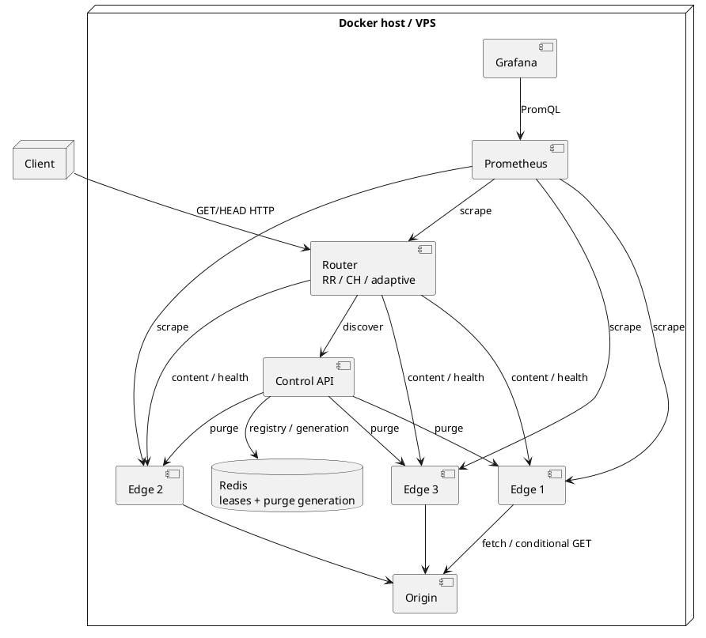
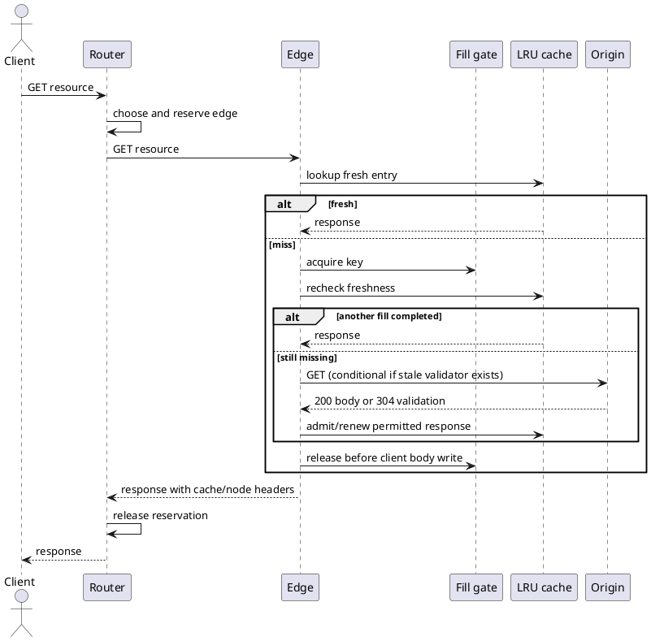
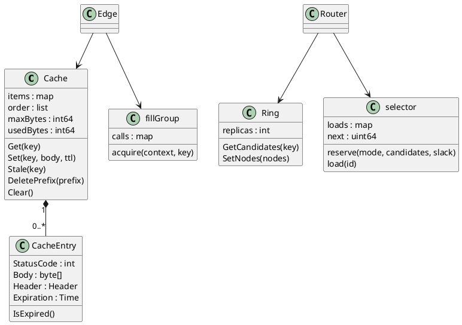

# MiniCDN SRS, UML and algorithm design

Group 21, CE, AY 2026-27. Guide: Dr. Sudhir N. Dhage. Revision: 10 October 2026.

## Purpose and problem

Build an inspectable distributed static-content delivery prototype. Repeated origin fetches waste work, while routing every popular key to its hash owner can concentrate requests. Spreading every request uniformly can duplicate cached objects and reduce effective cache capacity. The project exposes that tradeoff through controlled algorithms, observable cache behavior, and reproducible workloads.

The project contribution is an experimental platform and an evaluated routing heuristic. Consistent hashing, LRU, conditional HTTP validation, request coalescing and cache-aware balancing are established techniques. No claim that commercial CDNs lack them is justified by this implementation.

## Stakeholders and operating assumptions

Content clients request public static assets. Operators start services and issue invalidation requests. Evaluators inspect code, tests, data and Grafana. The origin is the authoritative content source. Redis is the single control-plane registry and invalidation-generation store. All three edges in the local demonstration share one host/network; region labels do not prove geographic distribution.

Edge cache identity is the decoded request path plus raw query, within one configured origin. The router hashes the escaped request URI including its raw query. Query ordering is preserved; equivalent encoded spellings may route differently. Encoded-path normalization requires additional validation before wider deployment. Authorization, Cookie, Range and explicit request Cache-Control bypass shared storage. Vary and Set-Cookie responses are excluded. GET responses with status 200 and positive permitted TTL may be cached; HEAD can use a cached GET body's headers without returning the body. The implementation is a scoped prototype, not complete RFC compliance or multi-tenant CDN hosting.

## Functional requirements and evidence

| ID | Requirement | Acceptance/evidence |
| --- | --- | --- |
| FR01 | Serve origin content through router and edge | HTTP 200 body matches the requested fixture; query variants remain isolated |
| FR02 | Provide selectable round robin, hash and adaptive policies | ROUTING_MODE validated at startup; response identifies mode; selection tests and common workload traces |
| FR03 | Enforce memory-body capacity and LRU eviction | CACHE_MAX_BYTES, oversized rejection, replacement accounting and least-recent eviction tests; metadata is extra; entry count capped at 10,000 |
| FR04 | Coordinate concurrent same-key cacheable fills | 32-client controlled burst compares independent origin attempts to one coordinated fill; independent keys continue |
| FR05 | Respect freshness and conditionally validate stale entries | Expired content is withheld until origin validates or replaces it; 304 renews body freshness; private/no-store bypass storage |
| FR06 | Invalidate exact keys and URL prefixes | POST purge acknowledged per active edge; prefix includes matching query variants; partial failures return HTTP 502 |
| FR07 | Recover invalidations missed by returning edges | Redis increments generation before broadcast; a detected gap causes a conservative full-cache flush; heartbeat checks retained generation |
| FR08 | Discover healthy edges and fall back | One-second discovery loop, parallel one-second health probes; no locks held across proxy I/O; failed GET/HEAD connection attempts can try another edge |
| FR09 | Export operating metrics and dashboard | Content traffic, hits, latency, origin attempts, coalesced requests, body bytes, evictions and healthy edge count visible through Prometheus/Grafana |
| FR10 | Reproduce experiments | Seed, capacity, workload, concurrency, origin delay, all errors and raw request timings recorded; cold state reset acknowledged by all edges |

## Nonfunctional requirements

NFR01 Correctness: no stale object is served merely because it remains in the bounded cache; validation is mandatory after expiry. Client conditional headers take precedence by ETag before modification date. Oversized bodies stream without admission. Coalescing shares only cacheable content.

NFR02 Concurrency: shared state is locked; fills are keyed; cancelled waiting requests release references. Purge uses an exclusive edge cache-operation barrier. This favors correctness but can make purge wait for slow responses, a measurable limitation.

NFR03 Performance: measure P50/P95/P99, successful throughput, request-count coefficient of variation, cache hit ratio and origin attempts. The proposal's >85% hit and <5 second failover are workload-dependent targets, not blanket guarantees. Router connections have a 500 ms dial deadline and 1.5 s response-header deadline after a measured eight-second failure exposed a problem. The complete response retains a 12 s timeout, so a stalled body or host scheduling delays can still exceed the target. Record the tested failure type and timing boundary.

NFR04 Reproducibility: closed-loop clients, equal trace/capacity/TTL and sequential policy trials. Repeat three times and rotate policy order. Record machine/container versions; report ranges across runs. Prometheus histogram percentiles are estimates and do not replace raw client latency samples.

NFR05 Deployment: expose only HTTPS entry points on a VPS. Keep Redis, control, edges and Prometheus internal. Require a non-default Grafana password. Persist Redis AOF and Grafana data. Public hosting requires a host, DNS and credential configuration.

NFR06 Maintainability: separate origin, control, router, cache, hash and edge modules. Keep tests beside modules, a versioned experiment script and concise commit/branch conventions. A clean passing revision is required before release.

## Interface contract

GET/HEAD /{resource}: client content path via router. X-Edge-Node identifies serving edge, X-Cache reports HIT/MISS/REVALIDATED/BYPASS, X-Routing-Mode identifies policy.

GET /api/v1/nodes: control returns currently leased nodes. POST /api/v1/nodes: heartbeat registration, returns purge_generation. Five-second heartbeat, 15-second lease. Router independently probes /health.

POST /api/v1/purge: {"urls":["/file?x=1"],"prefixes":["/assets/"]}. Control persists generation and broadcasts /internal/purge. Empty URL/prefix arrays are rejected. Prefixes must begin with /. The local control API is unauthenticated and must remain internal for public hosting.

GET /metrics: edge/router Prometheus scrape interface. GET /health: process health and operating summary. Registry membership is not a substitute for a successful health check.

## UML source: component/deployment

## UML source: cache miss sequence

## UML source: class relationships

## Algorithm design

Round robin: snapshot healthy IDs, sort lexically, choose next modulo N under selector mutex, increment counter and reserve one in-flight request. Return remaining IDs in cyclic fallback order. Complexity O(N log N) for the small snapshot implementation. Equal request counts do not imply equal processing cost.

Consistent hashing: hash full path/query with CRC32, binary-search 50 virtual nodes per physical edge, traverse clockwise for unique fallback candidates, and reserve the first healthy candidate. Owner lookup is O(log V); complete candidate generation can scan O(V), with V=50N. This CRC32 ring is a demonstrator and its empirical distribution must be measured rather than assumed uniform.

Adaptive spillover: begin with hash owner and find the least-loaded healthy candidate using router-local in-flight counts. Keep owner unless owner_load > minimum_load + ADAPTIVE_SLACK (default 2). Otherwise use least-loaded candidate. Reserve atomically with selection, release on completion, account for fallback attempts separately. The rule has O(N) load selection after candidate construction. Multiple routers do not share load state, so experiments use one active policy router at a time.

Fill coordination: perform initial cache lookup, acquire a cancellable per-key gate on GET miss, recheck cache without double-counting lookup, fetch/validate only if needed, publish eligible response and release gate before serving body. Followers reuse the completed fill. Large/noncacheable responses are not admitted or shared as cached responses.

Revalidation: retain expired entry under the same capacity bound, send its ETag or Last-Modified validator, merge 304 headers, renew permitted TTL and serve retained body. A 200 response replaces content only if cacheable. No validation means no stale serving.

Invalidation: persist incremented generation in Redis, broadcast exact/prefix purge, return per-edge acknowledgements. An edge applies purge behind an exclusive cache-operation barrier. A generation gap forces full flush; a later heartbeat with newer generation also forces full flush. This is centralized recovery, not gossip, globally atomic invalidation, or a guarantee of zero stale reads while disconnected.

## Test traceability and release limits

FR02: cmd/router/routing_test.go. FR03: pkg/cache/bounded_test.go. FR04: cmd/edge/coalescing_test.go. FR05: cmd/edge/main_test.go and revalidation_test.go. FR06/07: purge_recovery_test.go and live interrupted-node test. FR01/08/09: live Compose smoke/failure/dashboard checks. FR10: scripts/compare-routing.mjs plus recorded JSON/CSV/raw samples.

Disk caching remains absent. Cache body bytes exclude metadata, temporary response buffers and Go runtime overhead. Automatic cross-edge replication and global origin-budget enforcement remain future work. HTTP upstream is local/trusted. A VPS deployment remains a single host with multiple processes and does not demonstrate geographical CDN performance.
