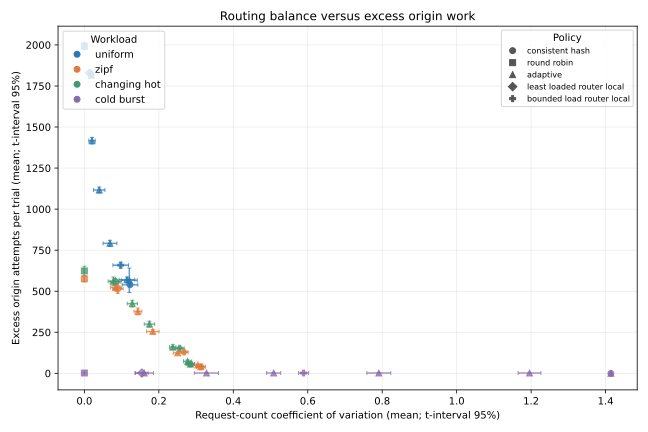
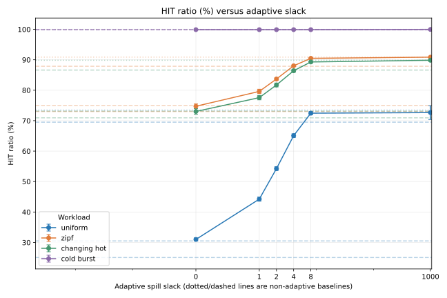
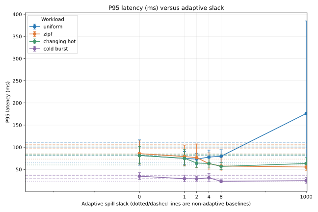
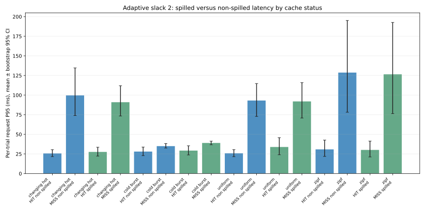

# Locality versus Balance in Finite-Capacity Edge Caches

**Research manuscript draft — 26 October 2026**

> Draft status: the measured core results and analysis are included. Before
> submission, the authors must complete the author/affiliation block, broaden
> the related-work survey to the institution's required minimum, review the
> claims and interpretation, and run the optional sensitivity sweeps. No
> unmeasured or estimated result is presented as a measurement.

## Abstract

Routing requests to a stable hash owner preserves cache locality, while
spreading requests can improve request-count balance but duplicate fills across
finite-capacity edge caches. We evaluate this trade-off in MiniCDN, a
single-host Docker prototype, using four seeded synthetic workloads and
consistent hashing, round robin, adaptive spillover, least-loaded router-local
routing, and a bounded-load router-local heuristic. In a retained 768-request
comparison, consistent hashing achieved an 80.34% HIT ratio on Zipf demand,
versus 76.69% for adaptive routing; round robin achieved 65.49%. In a new
10-repetition sweep of 3,000 measured requests per trial, increasing adaptive
slack improved locality-sensitive outcomes: under Zipf demand, mean HIT ratio
rose from 74.74% at slack 0 to 90.87% at slack 1000, while excess origin
attempts fell from 523.5 to 39.8 per trial. Request-count coefficient of
variation rose over the same settings, exposing the balance/locality trade-off.
The effect was workload-dependent: the repeated-key cold-burst workload
required one origin attempt under consistent hashing and slack 1000 but three
under several spillover settings. A separate per-request analysis did not
support a universal explanation that spilled requests cause higher tail
latency. One uniform/slack-1000 condition recorded 19 errors among 30,000
requests; its P95 is therefore reported with that caveat. Results are
descriptive of a closed-loop, single-host synthetic setup, not production CDN
performance.

**Index Terms—** content delivery networks, consistent hashing, caching,
request routing, finite cache capacity, load balancing.

## 1. Introduction

An edge cache's routing policy determines which requests share a cache. Stable
key ownership tends to concentrate each object's copies, preserving effective
capacity. A request-balanced policy can instead send the same key to different
edges, increasing duplicate fills and eviction pressure. Under finite capacity,
the policy must trade off locality, balance, origin work, and latency.

This paper asks: **How does request-load-aware spillover change cache locality,
origin work, request-count balance, and client latency under finite edge-cache
capacity?** The work evaluates an experimental platform rather than proposing
a new hashing theorem or a production-ready CDN design. Its principal
contributions are (i) an instrumented router benchmark with per-request serving
edge, hash owner, cache status, spill indicator, and latency; (ii) a repeated
slack sweep with a distinct-key lower bound on origin work; and (iii) a
comparison to two explicitly router-local load heuristics.

The results are mixed, not a blanket win for adaptive routing. For uniform and
Zipf workloads, higher slack improves hit ratio and reduces excess origin
attempts, at the cost of higher request-count CV. However, the near-pure-hash
slack setting performs much like consistent hashing, while some intermediate
settings still trail it. Cold-burst traces favor keeping a repeated key
together. The spill-latency data varies by workload and cache status, and does
not establish that spillover universally explains tail latency.

## 2. Related Work

Consistent hashing supports stable object assignment when server membership
changes, and the foundational work also studies random cache trees for hot-spot
relief [1]. Consistent hashing with bounded loads formalizes a balance/movement
trade-off for assigning clients to servers under a capacity bound [2]. Its
allocation-count guarantees do not directly imply a request-latency guarantee
when requests have nonuniform popularity or different service costs. Later
work identifies cascaded overflow in bounded-load hashing and proposes a
minwise-hashing-based alternative [3]. The router-local heuristic in this
study is not an implementation of either paper's algorithm.

Cache-aware load balancing has also been deployed for data-center search
applications, where queries contain multiple terms and a weighted voting
scheme combines term locality with replica selection [4]. MiniCDN instead
routes one HTTP resource key per request and uses synthetic traces; its
mechanism and evaluation are not directly comparable to that production
system. Cache stampede prevention addresses concurrent regeneration of expired
objects [5]. MiniCDN's cache-fill coalescing is a separate mechanism; this
study's routing comparisons do not claim to evaluate probabilistic early
expiration.

HTTP conditional request behavior follows RFC 9110. In particular, when
`If-None-Match` is present, it takes precedence over `If-Modified-Since`;
the origin handler is tested against this ordering [6].

## 3. System and Routing Policies

MiniCDN comprises a router, three edge caches, an origin, and a Redis-backed
control service, run through Docker Compose. Edge caches use bounded body-byte
capacity and LRU replacement. The experiments configure each edge with 64 KiB
of body capacity and each origin object with 1 KiB. Metadata and transient
buffers are not included in the body-byte capacity.

The router exposes these policies:

* **Consistent hash:** route a key to its hash owner.
* **Round robin:** rotate requests across the healthy edges.
* **Adaptive spillover:** preserve the hash owner unless its router-local
  in-flight reservation count exceeds the least-loaded candidate by more than
  the configured slack. Slack is swept over 0, 1, 2, 4, 8, and 1000; 1000 is
  an approximate pure-hash endpoint for this workload, not a separate
  algorithm.
* **Least-loaded router-local:** select the edge with the fewest in-flight
  requests visible to this router.
* **Bounded-load router-local:** a local in-flight heuristic that limits
  selection according to a configurable capacity factor (2 in this run).
  This is not the bounded-load consistent-hashing algorithm of [2].

Load state is maintained by the individual router and is not shared between
router instances. Results for the two least-loaded variants are therefore
labelled router-local.

## 4. Experimental Method

### 4.1 Workloads and configuration

The main sweep uses uniform, Zipf (exponent 1.1), changing-hot-set, and
repeated-key cold-burst traces. Each trial contains 256 warm-up requests,
followed by an acknowledged cache purge and 3,000 measured requests. Seeds
derive deterministically from base seed 2100260 plus the run index. Each
condition has ten repetitions. The base configuration is concurrency 16,
256 objects of 1 KiB each, 64 KiB body capacity per edge, and 20 ms origin
delay. Cache TTL is one hour. The setup is closed-loop and runs on one Docker
host without network impairment.

The adaptive slack sweep contains six slack values across four workloads
(240 trials); a separate baseline sweep measures two router-local policies
across four workloads (80 trials). The common original policy measurements
are included with those trials in the generated analysis. The resulting
analysis contains 400 trial rows. Warm-up traffic is not included in trial
metrics; each measured trial begins after its cache purge.

### 4.2 Metrics and analysis

HIT ratio is the fraction of measured requests reported as cache hits. Origin
attempts are counted by trial. For each trial, the **compulsory-miss floor** is
the number of distinct requested keys after the cache reset. **Excess origin
attempts** are defined as origin attempts minus this floor. The floor is a
trace-specific lower bound under the cold-start setup; excess attempts capture
additional work such as duplicate fills. Request-count coefficient of
variation (CV) is computed across the three edge request counts.

Client P50, P95, and P99 are computed per trial. Request instrumentation
records trial ID, key, serving edge, hash-owner edge, whether the request was
spilled, `X-Cache`, and client latency. Spill analyses first compute
per-trial percentiles in each workload/cache-status/spill group, then summarize
across repetitions; individual requests are not treated as independent
replicates.

For trial-level hit ratio, origin attempts, distinct-key floor, excess
attempts, and request CV, the analysis reports two-sided 95% Student
t-intervals over independent trials. For latency percentiles and error counts,
it reports deterministic 10,000-resample percentile bootstrap intervals for
the mean, resampling at the trial level (seed 3102026). These intervals
describe variation across this experiment's trials; they are not guarantees
about production workloads.

## 5. Results

All figures and numerical tables below are generated from named result files,
not manually estimated values. Historical and new experiments are kept
separate because they use different repetitions and trace lengths.

### 5.1 Reproduction of the retained comparison

The retained 10 October dataset was not modified. Its Zipf HIT rates were
80.34% for consistent hash, 65.49% for round robin, and 76.69% for adaptive.
Mean Zipf origin attempts were 151, 265, and 179, respectively. Uniform HIT
rates were 60.89%, 21.09%, and 48.44%. The regenerated per-trial distinct-key
means were 151.00 (Zipf), 176.33 (changing hot), 242.67 (uniform), and 1.00
(cold burst). These values are reproduced from the retained
`docs/academic/results/routing-comparison.json` and
`routing-requests.jsonl`; derived tables are in
`docs/academic/results/routing-reproduction-2026-10-25.json`,
`routing-reproduction-2026-10-25.md`, and
`routing-trials-derived-2026-10-25.csv`.

| Workload | Policy | HIT (%) | Origin attempts | Distinct-key floor | Excess attempts |
|---|---|---:|---:|---:|---:|
| Zipf | Consistent hash | 80.34 | 151.00 | 151.00 | 0.00 |
| Zipf | Round robin | 65.49 | 265.00 | 151.00 | 114.00 |
| Zipf | Adaptive | 76.69 | 179.00 | 151.00 | 28.00 |
| Uniform | Consistent hash | 60.89 | 300.33 | 242.67 | 57.66 |
| Uniform | Round robin | 21.09 | 606.00 | 242.67 | 363.33 |
| Uniform | Adaptive | 48.44 | 396.00 | 242.67 | 153.33 |

The table's per-policy origin-attempt values are means across the retained
trials; the distinct-key floor is a mean across three traces, so the excess
column here is an illustrative difference of means. The per-trial exact
arithmetic is in the cited CSV.

### 5.2 Slack sweep and baselines

In the extended sweep, slack shifts the outcome from balanced routing toward
locality. Under uniform demand, adaptive HIT ratio rises from 30.99% (slack 0)
to 72.66% (slack 1000), while mean excess attempts fall from 1814.2 to 567.0
per 3,000-request trial. Under Zipf demand, HIT ratio rises from 74.74% to
90.87%, and excess attempts fall from 523.5 to 39.8. Request CV increases
from 0.084 to 0.313 for Zipf. At slack 1000, the Zipf values closely match
consistent hashing (90.88% HIT; 39.4 excess attempts; CV 0.313). The full
workload-by-slack table and intervals are in
`routing-analysis-2026-10-26-summary.csv`.

For Zipf, slack 2 gives an intermediate operating point, not the best
locality: it records 83.70% HIT, 254.9 excess attempts, CV 0.184, and mean
P95 76.6 ms. Consistent hash records 90.88%, 39.4, 0.313, and 73.3 ms;
round robin records 73.02%, 575.3, 0.000, and 106.2 ms. Least-loaded
router-local gives 75.00%, 515.8, 0.090, and 97.8 ms; bounded-load
router-local gives 87.88%, 129.5, 0.268, and 85.0 ms. These are means across
ten trials for each condition and are not a universal policy ranking.

For the repeated-key cold-burst workload, each trial has a distinct-key floor
of one. Consistent hash and adaptive slack 1000 each average one origin
attempt and 99.97% HIT. Several lower slack values average three origin
attempts and 99.90% HIT because concurrent requests can be served on multiple
edges. Slack 1000 has request CV 1.414 in this workload, illustrating that
preserving a single key's locality can coexist with strongly uneven request
counts.

One error-bearing condition must be retained in interpretation: adaptive
uniform at slack 1000 had 19 measured request errors among 30,000 requests.
Its P95 mean is 176.2 ms (bootstrap 95% interval [62.4, 384.9] ms); the
interval is wide and the condition has errors, so this latency is not evidence
of a reliable performance advantage. The other measured trial conditions
recorded zero request errors. Exact totals and individual trial IDs are in
`routing-analysis-2026-10-26-summary.csv`.

### 5.3 Spilled versus non-spilled latency

For adaptive slack 2, the request-level output is reduced to per-trial P50/P95
for each workload, HIT/MISS status, and spill state. In the 10-repetition
sweep, spilled MISS P95 is higher than non-spilled MISS P95 for cold-burst
(39.0 vs. 35.0 ms), but lower for changing-hot (91.0 vs. 99.7 ms), uniform
(92.0 vs. 93.1 ms), and Zipf (126.5 vs. 128.7 ms). HIT groups also vary, and
their low P95 ranges do not consistently make spilled requests slower. The
measured result therefore **does not support a general claim** that spilled
requests landing on cold edges explain adaptive's high P95. Full P50/P95
intervals and trial counts are in
`routing-analysis-2026-10-26-spill-summary.csv`; request rows are in the
dated sweep `*-requests.csv` exports.

### 5.4 Figures

Vector PDF and SVG versions are in `docs/academic/results/figures/`; the
underlying trial summaries are in the result CSVs referenced above.

## 6. Validator Correctness

The origin handler follows RFC 9110 conditional-request precedence: if
`If-None-Match` is present, `If-Modified-Since` is not used to produce a
not-modified response. Regression tests exercise the actual file handler and
verify (i) a mismatching ETag plus a future modification date returns 200,
(ii) a matching ETag returns 304, and (iii) `If-Modified-Since` alone can
return 304. The test cases are in `cmd/origin/main_test.go`; the implementation
is in `cmd/origin/main.go`. The full Go suite run through Docker passed with
46.1% total statement coverage at the validator-fix revision and 46.9% after
the router baseline tests were added. Both coverage numbers describe the full
repository at their respective revisions, not just the origin.

## 7. Discussion

Increasing slack improves measured reuse and decreases excess origin work in
the uniform and Zipf sweeps, but also raises request-count CV and does not
establish that a load-aware policy outperforms consistent hashing overall.
The round-robin result highlights the cost of spreading repeated keys without
shared cache state. The bounded-load router-local heuristic occupies an
intermediate point in some Zipf metrics but is an implementation-specific
comparison, not a theoretical bounded-load guarantee.

The retained comparison's adaptive policy performed below consistent hashing
on Zipf HIT ratio and P95. The longer sweep's highest slack behaves nearly as
pure hash on Zipf; this supports a locality-dominant interpretation for that
trace, not a conclusion that all hot or dynamic workloads should use hashing.
Changing-hot results also show the value of locality in this finite trace but
do not model real workload phase changes. Cold-burst's floor is especially
informative: origin attempts beyond one are duplicate work relative to the
trace's unique-key count.

The spill analysis rejects the initial simple explanation of a universal
cold-edge penalty. Because the result is per-trial percentile summaries rather
than randomized assignment of spill status, it is observational: spill status
is correlated with routing conditions and is not a causal treatment.

## 8. Threats to Validity

The experiment uses one Docker host, a closed-loop client, synthetic traces,
three edge instances, and a synthetic fixed origin delay. It does not establish
behavior under open-loop arrivals, WAN latency, heterogeneous edges, real
production request distributions, large objects, multi-router shared load
state, or changing membership. The load estimates are router-local and
unshared. The finite set of four workload generators and one Zipf exponent
limits generalization. A single condition contains 19 errors; its error count
and latency are disclosed rather than discarded. The error cause is not
established by the recorded data. The bootstrap intervals use ten trial-level
replicates per condition and should be interpreted as uncertainty summaries,
not as a substitute for more independent hosts or workloads.

The distinct-key floor measures compulsory misses for a cold-start trace; it
does not account for prewarmed caches, evictions, revalidation policy, or
external cache sharing. The reported capacity is body bytes only; cache
metadata and runtime overhead are excluded. The measured outcomes depend on
the implementation's hash ring, object ordering, concurrency, and the
per-trial cache purge.

## 9. Conclusion

The observed trade-off is measurable but workload-dependent. In uniform and
Zipf traces, higher adaptive slack moves toward hash locality, improving HIT
ratio and lowering excess origin attempts while increasing request-count
imbalance. Round robin balances counts but pays more duplicate origin work.
Consistent hashing performs strongly on locality-sensitive workloads, and
slack 1000 approximates it on Zipf. Repeated-key cold bursts further show that
spillover can turn one compulsory fill into multiple origin attempts. The
per-request evidence does not show that spilled requests are universally
slower, so higher P95 should not be attributed to cold-edge spillover without
additional causal experiments.

The result is an evidence-backed evaluation of a small prototype, not a
production deployment recommendation. Future work should run cache-size,
origin-delay, and Zipf-exponent sensitivity sweeps; repeat experiments on
independent hosts and open-loop arrivals; investigate the error-bearing
condition; and compare with a faithful bounded-load consistent-hashing
implementation.

## Data and Reproducibility

The retained source dataset is `docs/academic/results/routing-comparison.json`
and `routing-requests.jsonl`; it was verified unchanged by SHA-256. New
results used here are:

* `routing-sweep-2026-10-25T19-23-50-602Z.json` plus its CSV and per-request
  exports (adaptive slack sweep).
* `routing-sweep-2026-10-26T04-11-47-711Z.json` plus its CSV and per-request
  exports (router-local baselines).
* `routing-analysis-2026-10-26.md`, `.json`, `-summary.csv`,
  `-spill-trials.csv`, and `-spill-summary.csv` (derived analysis).
* `routing-reproduction-2026-10-25.json`, `.md`, and
  `routing-trials-derived-2026-10-25.csv` (retained data reproduction).

Analysis is regenerated with Docker Python and `scripts/analyze-routing-sweep.py`.
The sweep harness is `scripts/compare-routing.mjs`. Exact commands, test
outcomes, and outstanding work are recorded in `REPORT.md`.

## References

[1] D. Karger, E. Lehman, T. Leighton, M. Levine, D. Lewin, and R. Panigrahy,
“Consistent Hashing and Random Trees: Distributed Caching Protocols for
Relieving Hot Spots on the World Wide Web,” in *Proc. 29th ACM Symp. Theory of
Computing*, 1997, pp. 654–663, doi: 10.1145/258533.258660.

[2] V. Mirrokni, M. Thorup, and M. Zadimoghaddam, “Consistent Hashing with
Bounded Loads,” in *Proc. 29th ACM-SIAM Symp. Discrete Algorithms*, 2018,
pp. 587–604, doi: 10.1137/1.9781611975031.39.

[3] J. Chen, B. Coleman, and A. Shrivastava, “Revisiting Consistent Hashing
with Bounded Loads,” in *Proc. AAAI Conf. Artificial Intelligence*, vol. 35,
no. 5, 2021, pp. 3976–3983, doi: 10.1609/aaai.v35i5.16517.

[4] A. Archer, K. Aydin, M. H. Bateni, V. Mirrokni, A. Schild, R. Yang, and
R. Zhuang, “Cache-Aware Load Balancing of Data Center Applications,” *Proc.
VLDB Endowment*, vol. 12, no. 6, pp. 709–723, 2019,
doi: 10.14778/3311880.3311887.

[5] A. Vattani, F. Chierichetti, and K. Lowenstein, “Optimal Probabilistic
Cache Stampede Prevention,” *Proc. VLDB Endowment*, vol. 8, no. 8,
pp. 886–897, 2015, doi: 10.14778/2757807.2757813.

[6] R. Fielding, M. Nottingham, and J. Reschke, “HTTP Semantics,” RFC 9110,
June 2022, sec. 13.1.2. [Online]. Available:
https://www.rfc-editor.org/rfc/rfc9110.html#section-13.1.2.
