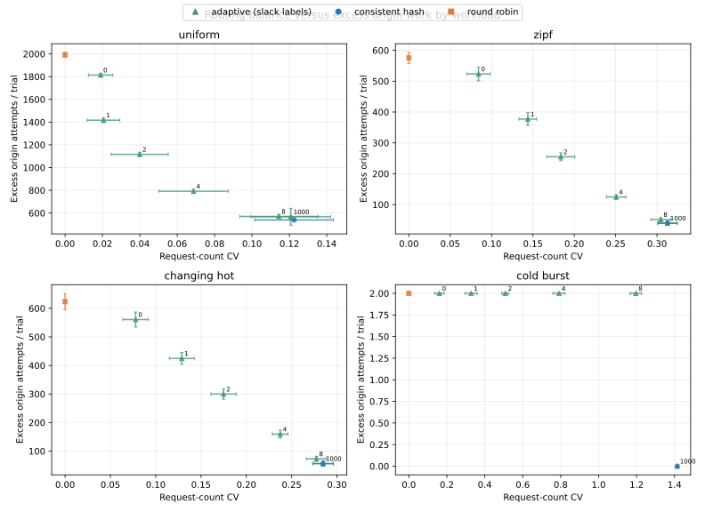
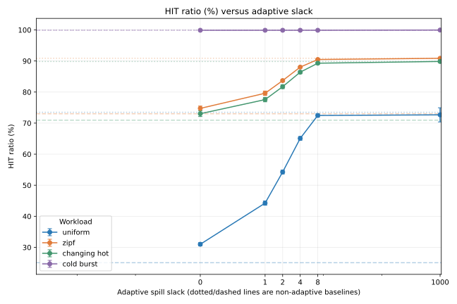
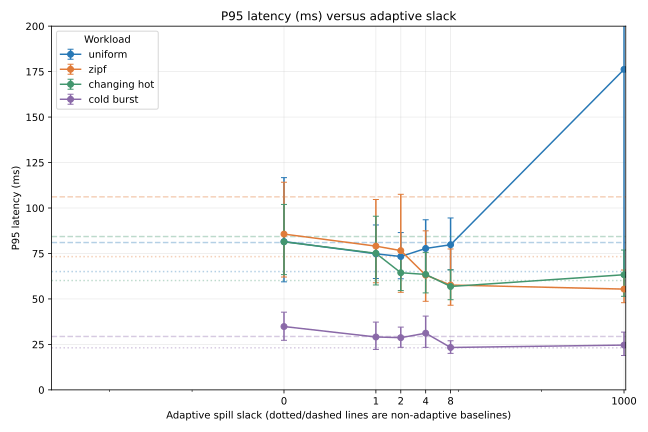
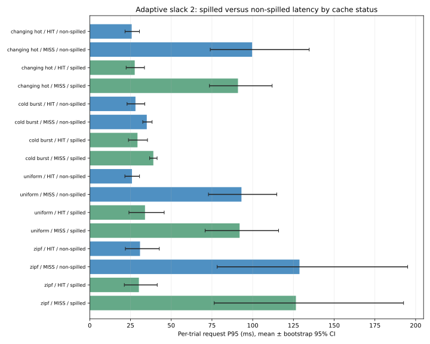
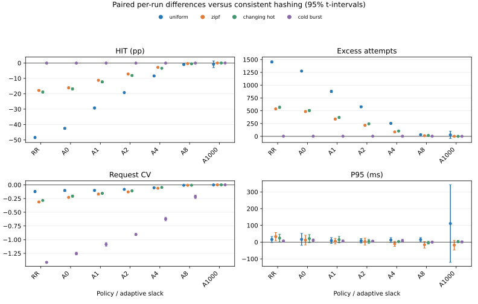

# Locality versus Balance in Finite-Capacity Edge Caches

**Research manuscript draft — 3 November 2026**

> Draft status: suitable as a presentation draft, not yet submission-ready.
> Claims below use the completed retained comparison and the 320-trial
> same-session sweep only. Router-local measurements from a separate session
> and an incomplete follow-up sweep are excluded from the primary comparisons.
> Author details, remaining validation, and further experiments are pending.

## Abstract

Routing requests to a stable hash owner preserves cache locality, while
spreading requests can improve request-count balance but duplicate fills in
finite-capacity edge caches. In MiniCDN, a single-host Docker prototype, a
10-repetition, 3,000-request-per-trial sweep compares consistent hashing,
round robin, and adaptive spillover across four seeded synthetic workloads.
Under Zipf demand, adaptive cache-hit ratio rose from 74.74% at slack 0 to 90.87% at
slack 1000 while excess origin attempts fell from 523.5 to 39.8 per trial;
request-count coefficient of variation rose from 0.084 to 0.313. In the repeated-key cold-burst
trace, consistent hashing and slack 1000 averaged one origin attempt, whereas
round robin and adaptive slack 0--8 averaged three. Paired intervals show
round robin's Zipf 95th-percentile latency exceeds consistent hashing by
32.88 ms (95% confidence interval [8.18, 57.59]), while adaptive-sweep
comparisons do not support a latency ranking. At slack 2, the 95th-percentile
latency of spilled cache misses was not consistently higher than that of
non-spilled cache misses across workloads. One completed uniform/slack-1000 condition
contained 19 errors; a later same-session baseline attempt also failed and is
excluded. These results describe a closed-loop, single-host synthetic setup,
not production CDN performance.

**Index Terms—** content delivery networks, consistent hashing, edge computing,
caching, load balancing.

## 1. Introduction

An edge cache's routing policy determines which requests share a cache. Stable
key ownership tends to concentrate each object's copies, preserving effective
capacity. A request-balanced policy can instead send the same key to different
edges, increasing duplicate fills and eviction pressure. Under finite capacity,
the policy must trade off locality, balance, origin work, and latency.

This paper asks: **How does request-load-aware spillover change cache locality,
origin work, request-count balance, and client latency under finite edge-cache
capacity?** The work evaluates an experimental platform rather than proposing
a new hashing theorem or a production-ready CDN design. Its principal
contributions are (i) an instrumented router benchmark with per-request serving
edge, hash owner, cache status, spill indicator, and latency; (ii) a repeated
slack sweep with a distinct-key lower bound on origin work; and (iii) an
analysis of spilled-request latency split by HIT/MISS.

The results are mixed, not a blanket win for adaptive routing. For uniform and
Zipf workloads, higher slack improves hit ratio and reduces excess origin
attempts, at the cost of higher request-count CV. However, the near-pure-hash
slack setting performs much like consistent hashing, while some intermediate
settings still trail it. Cold-burst traces favor keeping a repeated key
together. The spill-latency data varies by workload and cache status, and does
not establish that spillover universally explains tail latency.

## 2. Related Work

Consistent hashing supports stable object assignment when server membership
changes, and the foundational work also studies random cache trees for hot-spot
relief [1]. Consistent hashing with bounded loads formalizes a balance/movement
trade-off for assigning clients to servers under a capacity bound [2]. Its
allocation-count guarantees do not directly imply a request-latency guarantee
when requests have nonuniform popularity or different service costs. Later
work identifies cascaded overflow in bounded-load hashing and proposes a
minwise-hashing-based alternative [3]. The router-local heuristic in this
study is not an implementation of either paper's algorithm.

Locality-Aware Request Distribution (LARD) combines request-content affinity
with backend load to improve cache locality while balancing a cluster [4].
It is the closest conceptual predecessor to this study's locality/load
trade-off. MiniCDN does not dynamically partition a working set: it begins
with a consistent-hash owner and redirects only when router-local in-flight
counts cross a slack threshold. The power-of-two-choices literature studies
load reduction by selecting among two candidate queues [5]; MiniCDN instead
compares the hash owner with the least-loaded available ring candidate, so it
is not a power-of-two-choices implementation.

Production systems combine hashing and load distribution at different
layers. Maglev is Google's software network load balancer, using consistent
hashing and connection tracking, and the authors report its use for Google
traffic [6]. Nygren et al. describe the architecture and operation of
Akamai's distributed content-delivery platform [7]. Maggs and Sitaraman
connect algorithmic work to practical CDN subsystems and deployment
constraints [8]. These systems provide operational context but no directly
comparable MiniCDN cache-routing measurements.

CDN surveys describe broader system components, replication approaches,
request-redirection mechanisms, and evaluation methods [9], [15]. Sahoo et al.
survey replica-server placement methods, a closely related but distinct
problem: placement chooses where copies should reside, whereas our experiment
measures how a router selects among already-running finite-capacity caches.
Dynamic replica placement also studies where content copies should reside to
scale delivery [10];
this paper instead measures how a router selects among already-running
finite-capacity edge caches.

Cache-aware load balancing has also been deployed for data-center search
applications, where queries contain multiple terms and a weighted voting
scheme combines term locality with replica selection [11]. MiniCDN instead
routes one HTTP resource key per request and uses synthetic traces; its
mechanism and evaluation are not directly comparable to that production
system. Cache stampede prevention addresses concurrent regeneration of expired
objects [12]. MiniCDN's cache-fill coalescing is a separate mechanism; this
study's routing comparisons do not claim to evaluate probabilistic early
expiration.

HTTP conditional request behavior follows RFC 9110. In particular, when
`If-None-Match` is present, it takes precedence over `If-Modified-Since`;
the origin handler is tested against this ordering [13].

HAProxy's configuration manual documents least-connection balancing and
`hash-balance-factor`, which enables bounded-load consistent hashing [14].
This is a production-software reference point, not evidence that MiniCDN's
router-local capacity-factor heuristic matches HAProxy's algorithm or the
object-placement algorithm in [2].

## 3. System and Routing Policies

MiniCDN comprises a router, three edge caches, an origin, and a Redis-backed
control service, run through Docker Compose. Edge caches use bounded body-byte
capacity and LRU replacement. The experiments configure each edge with 64 KiB
of body capacity and each origin object with 1 KiB. Metadata and transient
buffers are not included in the body-byte capacity.

The router exposes these policies:

* **Consistent hash:** route a key to its hash owner.
* **Round robin:** rotate requests across the healthy edges.
* **Adaptive spillover:** preserve the hash owner unless its router-local
  in-flight reservation count exceeds the least-loaded candidate by more than
  the configured slack. Slack is swept over 0, 1, 2, 4, 8, and 1000; 1000 is
  an approximate pure-hash endpoint for this workload, not a separate
  algorithm.
The experimental least-loaded and bounded-load router-local modes are not
included in the primary results because their completed measurements were
collected in a separate Compose session; a later combined run did not
complete. They should not be read as same-session baseline comparisons. The
origin handler also follows RFC 9110 conditional-request precedence, with
regression tests covering `If-None-Match` versus `If-Modified-Since`.

## 4. Experimental Method

### 4.1 Workloads and configuration

The main sweep uses uniform, Zipf (exponent 1.1), changing-hot-set, and
repeated-key cold-burst traces. Each trial contains 256 warm-up requests,
followed by an acknowledged cache purge and 3,000 measured requests. Seeds
derive deterministically from base seed 2100260 plus the run index. Each
condition has ten repetitions. The base configuration is concurrency 16,
256 objects of 1 KiB each, 64 KiB body capacity per edge, and 20 ms origin
delay. Cache TTL is one hour. The setup is closed-loop and runs on one Docker
host without network impairment.

The primary same-session sweep contains consistent hashing, round robin, and
six adaptive slack values across four workloads (320 trials total). Warm-up
traffic is excluded from trial metrics; each measured trial begins after its
cache purge. Two additional router-local policies were measured in another
Compose session (80 trials), but those results are excluded from primary
comparisons to avoid a session confound. A later attempted combined baseline
run stopped at 68 of 200 trials and is not analyzed as a completed experiment.

### 4.2 Metrics and analysis

HIT ratio is the fraction of measured requests reported as cache hits. Origin
attempts are counted by trial. For each trial, the **compulsory-miss floor** is
the number of distinct requested keys after the cache reset. **Excess origin
attempts** are defined as origin attempts minus this floor. The floor is a
trace-specific lower bound under the cold-start setup; excess attempts capture
additional work such as duplicate fills. Request-count coefficient of
variation (CV) is computed across the three edge request counts.

Client P50, P95, and P99 are computed per trial. Request instrumentation
records trial ID, key, serving edge, hash-owner edge, whether the request was
spilled, `X-Cache`, and client latency. Spill analyses first compute
per-trial percentiles in each workload/cache-status/spill group, then summarize
across repetitions; individual requests are not treated as independent
replicates.

For trial-level hit ratio, origin attempts, distinct-key floor, excess
attempts, and request CV, the analysis reports two-sided 95% Student
t-intervals over independent trials. For latency percentiles and error counts,
it reports deterministic 10,000-resample percentile bootstrap intervals for
the mean, resampling at the trial level (seed 3102026). These intervals
describe variation across this experiment's trials; they are not guarantees
about production workloads.

## 5. Results

All figures and numerical tables below are generated from named result files,
not manually estimated values. Historical and new experiments are kept
separate because they use different repetitions and trace lengths.

### 5.1 Reproduction of the retained comparison

The retained 10 October dataset was not modified. Its Zipf HIT rates were
80.34% for consistent hash, 65.49% for round robin, and 76.69% for adaptive.
Mean Zipf origin attempts were 151, 265, and 179, respectively. Uniform HIT
rates were 60.89%, 21.09%, and 48.44%. The regenerated per-trial distinct-key
means were 151.00 (Zipf), 176.33 (changing hot), 242.67 (uniform), and 1.00
(cold burst). These values are reproduced from the retained
`docs/academic/results/routing-comparison.json` and
`routing-requests.jsonl`; derived tables are in
`docs/academic/results/routing-reproduction-2026-10-25.json`,
`routing-reproduction-2026-10-25.md`, and
`routing-trials-derived-2026-10-25.csv`.

| Workload | Policy | HIT (%) | Origin attempts | Distinct-key floor | Excess attempts |
|---|---|---:|---:|---:|---:|
| Zipf | Consistent hash | 80.34 | 151.00 | 151.00 | 0.00 |
| Zipf | Round robin | 65.49 | 265.00 | 151.00 | 114.00 |
| Zipf | Adaptive | 76.69 | 179.00 | 151.00 | 28.00 |
| Uniform | Consistent hash | 60.89 | 300.33 | 242.67 | 57.66 |
| Uniform | Round robin | 21.09 | 606.00 | 242.67 | 363.33 |
| Uniform | Adaptive | 48.44 | 396.00 | 242.67 | 153.33 |

The table's per-policy origin-attempt values are means across the retained
trials; the distinct-key floor is a mean across three traces, so the excess
column here is an illustrative difference of means. The per-trial exact
arithmetic is in the cited CSV.

### 5.2 Same-session policy and slack results

In the extended sweep, slack shifts the outcome from balanced routing toward
locality. Under uniform demand, adaptive HIT ratio rises from 30.99% (slack 0)
to 72.66% (slack 1000), while mean excess attempts fall from 1814.2 to 567.0
per 3,000-request trial. Under Zipf demand, HIT ratio rises from 74.74% to
90.87%, and excess attempts fall from 523.5 to 39.8. Request CV increases
from 0.084 to 0.313 for Zipf. At slack 1000, the Zipf values closely match
consistent hashing (90.88% HIT; 39.4 excess attempts; CV 0.313). The full
workload-by-slack table and intervals are in
`routing-analysis-primary-2026-11-03-summary.csv`, generated only from
`routing-sweep-2026-10-25T19-23-50-602Z.json`.

For Zipf, slack 2 gives an intermediate operating point: it records 83.70%
HIT, 254.9 excess attempts, and CV 0.184, compared with 90.88%, 39.4, and
0.313 for consistent hash. Round robin records 73.02% HIT, 575.3 excess
attempts, and CV 0.000. These group means are descriptive; paired comparisons
follow below. The unpaired P95 confidence intervals overlap for consistent
hash and adaptive slack 0--8.
Slack 1000's P95 interval also overlaps consistent hashing's, so the near
equality in HIT and excess origin work does not establish a latency advantage.

For the repeated-key cold-burst workload, each trial has a distinct-key floor
of one. Consistent hash and adaptive slack 1000 each average one origin
attempt and 99.97% HIT. Round robin and every adaptive setting from slack 0 through 8 average three
origin attempts and 99.90% HIT because concurrent requests can be served on
multiple edges. Slack 1000 has request CV 1.414 in this workload, illustrating that
preserving a single key's locality can coexist with strongly uneven request
counts.

One error-bearing condition must be retained in interpretation: adaptive
uniform at slack 1000 had 19 measured request errors among 30,000 requests.
Its P95 mean is 176.2 ms (bootstrap 95% interval [62.4, 384.9] ms); the
interval is wide and the condition has errors, so this latency is not evidence
of a reliable performance advantage. The other measured trial conditions
recorded zero request errors. Exact totals and individual trial IDs are in
`routing-analysis-primary-2026-11-03-summary.csv`. The same-seed 10-trial
replay of uniform/adaptive/slack-1000 had zero errors in 30,000 requests, but
does not erase the original observation; its source is
`routing-sweep-2026-10-26T05-10-19-985Z.json`.

### 5.3 Capacity-only prediction for uniform demand

With 64 KiB per edge and 1-KiB objects, each edge can hold 64 objects. For
256 uniformly requested keys, a capacity-only prediction is 64/256 = 25% HIT
for round robin and (3 x 64)/256 = 75% for consistent hash. The measured
round-robin HIT is 25.05% (95% t-interval [24.35, 25.75]); the consistent-hash
HIT is 73.49% ([73.15, 73.83]). The simple estimate is within the round-robin
interval and above the consistent-hash interval. This is a descriptive
capacity-model check, not an explanation of the residual. Measured values and
intervals come from `routing-analysis-primary-2026-11-03-summary.csv`; cache
and object configuration is in
`routing-sweep-2026-10-25T19-23-50-602Z.json`.

### 5.4 Paired differences versus consistent hashing

The primary sweep uses the same deterministic trace for each workload/run
across routing policies. We therefore computed per-run differences against
consistent hashing and two-sided 95% paired Student *t*-intervals with ten
pairs per workload/condition. HIT is reported as percentage-point difference;
the other metrics are on their original scales. The full machine-generated
table is `routing-analysis-primary-2026-11-03-paired.csv`, and the four-panel
figure is `results/figures/routing-analysis-primary-2026-11-03-paired-differences.pdf`.
The condition order was not randomized, so paired intervals do not eliminate
time/order effects; this remains a limitation. Intervals are not adjusted for
multiple comparisons and should be read as exploratory evidence.

On Zipf, round robin had a paired P95 difference of +32.88 ms versus
consistent hashing (95% CI [+8.18, +57.59]), while its HIT ratio was 17.86
percentage points lower. For every adaptive slack setting, the paired P95
interval versus consistent hash includes zero; therefore **no adaptive
latency ranking is claimed**. Paired HIT and excess-origin differences do
favor hash locality at low/intermediate slack; slack 1000 is indistinguishable
from consistent hash on Zipf HIT and excess attempts by these paired intervals.

### 5.5 Spilled versus non-spilled latency

For adaptive slack 2, the request-level output is reduced to per-trial P50/P95
for each workload, HIT/MISS status, and spill state. In the 10-repetition
sweep, spilled MISS P95 is higher than non-spilled MISS P95 for cold-burst
(39.0 vs. 35.0 ms), but lower for changing-hot (91.0 vs. 99.7 ms), uniform
(92.0 vs. 93.1 ms), and Zipf (126.5 vs. 128.7 ms). HIT groups also vary, and
their low P95 ranges do not consistently make spilled requests slower. The
measured result therefore **does not support a general claim** that spilled
requests landing on cold edges explain adaptive's high P95. Full P50/P95
intervals and trial counts are in
`routing-analysis-primary-2026-11-03-spill-summary.csv`; the underlying
request rows are in
`routing-sweep-2026-10-25T19-23-50-602Z-requests.csv`.

### 5.6 Spill fraction, MISS rate, and exploratory fit

For adaptive slack 2, the share of MISS responses among classified spilled
requests was 92.10% under uniform demand versus 39.03% for non-spilled
requests. This cache-status difference is not a latency effect or a causal
estimate. Across all adaptive trials, a pooled descriptive OLS fit of spill
fraction against HIT ratio has R² = 0.0023; the fit against excess origin
attempts has R² = 0.0216. The corresponding residual RMSEs are 17.851
percentage points and 469.415 attempts per trial. Spill fraction alone has
little pooled explanatory power across the combined workloads/slack settings;
the pooled fit should not be interpreted causally or as a predictive model.
The regression summary and trial residuals are in
`routing-analysis-primary-2026-11-03-spill-regression-summary.csv` and
`routing-analysis-primary-2026-11-03-spill-regression-trials.csv`. Per-trial
spill fractions are in `routing-analysis-primary-2026-11-03-spill-fraction-trials.csv`;
MISS rates by workload/slack/spill state are in
`routing-analysis-primary-2026-11-03-spill-miss-rates.csv`. Intervals are
computed across trial-level rates, not pooled requests; unavailable spill
groups remain `NA`.

### 5.7 Figures

*Source: `routing-sweep-2026-10-25T19-23-50-602Z.json`; plotted values and intervals: `routing-analysis-primary-2026-11-03-summary.csv`.*

*Source: `routing-sweep-2026-10-25T19-23-50-602Z.json`; plotted values and intervals: `routing-analysis-primary-2026-11-03-summary.csv`.*

*Source: `routing-sweep-2026-10-25T19-23-50-602Z.json`; plotted values and intervals: `routing-analysis-primary-2026-11-03-summary.csv`. Axis is capped at 200 ms; the annotated uniform/slack-1000 interval extends past the displayed scale and that condition had 19 errors.*

*Source: `routing-sweep-2026-10-25T19-23-50-602Z-requests.csv`; per-trial percentiles and intervals: `routing-analysis-primary-2026-11-03-spill-summary.csv`.*

*Source: `routing-sweep-2026-10-25T19-23-50-602Z.json`; paired differences and intervals: `routing-analysis-primary-2026-11-03-paired.csv`.*

Vector PDF and SVG versions and their underlying CSV summaries are in
`docs/academic/results/`; each plotted result is derived from the primary
same-session trial JSON and request CSV named above.

## 6. Discussion

Increasing slack improves measured reuse and decreases excess origin work in
the uniform and Zipf sweeps, but also raises request-count CV and does not
establish that a load-aware policy outperforms consistent hashing overall.
The round-robin result highlights the cost of spreading repeated keys without
shared cache state. Router-local baseline measurements are exploratory only
and are omitted from primary policy comparisons because they came from a
separate session.

The retained comparison's adaptive policy performed below consistent hashing
on Zipf HIT ratio and P95. The longer sweep's highest slack behaves nearly as
pure hash on Zipf; this supports a locality-dominant interpretation for that
trace, not a conclusion that all hot or dynamic workloads should use hashing.
Changing-hot results also show the value of locality in this finite trace but
do not model real workload phase changes. Cold-burst's floor is especially
informative: origin attempts beyond one are duplicate work relative to the
trace's unique-key count.

The spill analysis rejects the initial simple explanation of a universal
cold-edge penalty. Because the result is per-trial percentile summaries rather
than randomized assignment of spill status, it is observational: spill status
is correlated with routing conditions and is not a causal treatment.

## 7. Threats to Validity

The experiment uses one Docker host, a closed-loop client, synthetic traces,
three edge instances, and a synthetic fixed origin delay. It does not establish
behavior under open-loop arrivals, WAN latency, heterogeneous edges, real
production request distributions, large objects, multi-router shared load
state, or changing membership. The finite set of four workload generators
and one Zipf exponent limits generalization. One complete condition contains
19 errors; its count and latency are disclosed rather than discarded. A
same-seed replay had no errors, but the original failure cause remains
undetermined. A later interleaved comparison sweep stopped at 68 of 200
trials with 1,563 HTTP 502/503 request failures after routers logged response
header timeouts and unhealthy-ring responses. The underlying trigger was not
determined; that partial run is excluded from outcome comparisons. The earlier
router-local measurements also came from a separate Compose session and are
not used as primary baseline evidence. Intervals use ten trial-level
replicates per condition and are not a substitute for independent hosts or
workloads.

The distinct-key floor measures compulsory misses for a cold-start trace; it
does not account for prewarmed caches, evictions, revalidation policy, or
external cache sharing. The reported capacity is body bytes only; cache
metadata and runtime overhead are excluded. The measured outcomes depend on
the implementation's hash ring, object ordering, concurrency, and the
per-trial cache purge.

## 8. Conclusion

The observed trade-off is measurable but workload-dependent. In uniform and
Zipf traces, higher adaptive slack moves toward hash locality, improving HIT
ratio and lowering excess origin attempts while increasing request-count
imbalance. Round robin balances counts but pays more duplicate origin work.
Consistent hashing performs strongly on locality-sensitive workloads, and
slack 1000 approximates it on Zipf. Repeated-key cold bursts further show that
spillover can turn one compulsory fill into multiple origin attempts. The
per-request evidence does not show that spilled requests are universally
slower, so higher P95 should not be attributed to cold-edge spillover without
additional causal experiments.

The result is an evidence-backed evaluation of a small prototype, not a
production deployment recommendation. Future work should run cache-size,
origin-delay, and Zipf-exponent sensitivity sweeps; repeat experiments on
independent hosts and open-loop arrivals; investigate the error-bearing
condition; and compare with a faithful bounded-load consistent-hashing
implementation.

## Data and Reproducibility

The retained source dataset is `docs/academic/results/routing-comparison.json`
and `routing-requests.jsonl`; it was verified unchanged by SHA-256. New
results used here are:

* `routing-sweep-2026-10-25T19-23-50-602Z.json` plus its CSV and per-request
  exports (adaptive slack sweep).
* `routing-sweep-2026-10-26T04-11-47-711Z.json` plus its CSV and per-request
  exports (router-local baselines).
* `routing-analysis-primary-2026-11-03.md`, `.json`, `-summary.csv`,
  `-spill-trials.csv`, and `-spill-summary.csv` (primary-sweep-only analysis).
* `routing-reproduction-2026-10-25.json`, `.md`, and
  `routing-trials-derived-2026-10-25.csv` (retained data reproduction).

Primary analysis is regenerated with Docker Python and
`scripts/analyze-routing-sweep.py`; it uses only the 320-trial same-session
JSON and its request CSV. The separate-session router-local trial file and the
incomplete 68/200 run are deliberately excluded. The sweep harness is
`scripts/compare-routing.mjs`. Exact commands, test outcomes, and outstanding
work are recorded in `REPORT.md`.

## References

[1] D. Karger, E. Lehman, T. Leighton, M. Levine, D. Lewin, and R. Panigrahy,
“Consistent Hashing and Random Trees: Distributed Caching Protocols for
Relieving Hot Spots on the World Wide Web,” in *Proc. 29th ACM Symp. Theory of
Computing*, 1997, pp. 654–663, doi: 10.1145/258533.258660.

[2] V. Mirrokni, M. Thorup, and M. Zadimoghaddam, “Consistent Hashing with
Bounded Loads,” in *Proc. 29th ACM-SIAM Symp. Discrete Algorithms*, 2018,
pp. 587–604, doi: 10.1137/1.9781611975031.39.

[3] J. Chen, B. Coleman, and A. Shrivastava, “Revisiting Consistent Hashing
with Bounded Loads,” in *Proc. AAAI Conf. Artificial Intelligence*, vol. 35,
no. 5, 2021, pp. 3976–3983, doi: 10.1609/aaai.v35i5.16517.

[4] V. S. Pai, M. Aron, G. Banga, M. Svendsen, P. Druschel, W. Zwaenepoel,
and E. M. Nahum, “Locality-Aware Request Distribution in Cluster-Based
Network Servers,” in *Proc. 8th Int. Conf. Architectural Support for
Programming Languages and Operating Systems*, 1998, pp. 205–216,
doi: 10.1145/291006.291048.

[5] M. Mitzenmacher, “The Power of Two Choices in Randomized Load Balancing,”
*IEEE Trans. Parallel Distrib. Syst.*, vol. 12, no. 10, pp. 1094–1104, 2001,
doi: 10.1109/71.963420.

[6] D. E. Eisenbud, C. Yi, C. Contavalli, C. Smith, R. Kononov,
E. Mann-Hielscher, A. Cilingiroglu, B. Cheyney, W. Shang, and
J. D. Hosein, “Maglev: A Fast and Reliable Software Network Load Balancer,”
in *Proc. 13th USENIX Symp. Networked Systems Design and Implementation*,
2016, pp. 523–535. [Online]. Available:
https://www.usenix.org/conference/nsdi16/technical-sessions/presentation/eisenbud.

[7] E. Nygren, R. K. Sitaraman, and J. Sun, “The Akamai Network,”
*ACM SIGOPS Oper. Syst. Rev.*,
vol. 44, no. 3, pp. 2–19, 2010, doi: 10.1145/1842733.1842736.

[8] B. M. Maggs and R. K. Sitaraman, “Algorithmic Nuggets in Content
Delivery,” *ACM SIGCOMM Comput. Commun. Rev.*, vol. 45, no. 3,
pp. 52–66, 2015, doi: 10.1145/2805789.2805800.

[9] A. Vakali and G. Pallis, “Content Delivery Networks: Status and Trends,”
*IEEE Internet Computing*, vol. 7, no. 6, pp. 68–74, Nov. 2003,
doi: 10.1109/MIC.2003.1250586.

[10] Y. Chen, R. H. Katz, and J. D. Kubiatowicz, “Dynamic Replica Placement
for Scalable Content Delivery,” in *Peer-to-Peer Systems*, Lecture Notes in
Computer Science, 2002, pp. 306–318, doi: 10.1007/3-540-45748-8_29.

[11] A. Archer, K. Aydin, M. H. Bateni, V. Mirrokni, A. Schild, R. Yang, and
R. Zhuang, “Cache-Aware Load Balancing of Data Center Applications,” *Proc.
VLDB Endowment*, vol. 12, no. 6, pp. 709–723, 2019,
doi: 10.14778/3311880.3311887.

[12] A. Vattani, F. Chierichetti, and K. Lowenstein, “Optimal Probabilistic
Cache Stampede Prevention,” *Proc. VLDB Endowment*, vol. 8, no. 8,
pp. 886–897, 2015, doi: 10.14778/2757807.2757813.

[13] R. Fielding, M. Nottingham, and J. Reschke, “HTTP Semantics,” RFC 9110,
June 2022, sec. 13.1.2. [Online]. Available:
https://www.rfc-editor.org/rfc/rfc9110.html#section-13.1.2.

[14] HAProxy Technologies, “HAProxy Configuration Manual, Version 3.0,”
2026. [Online]. Available: https://docs.haproxy.org/3.0/configuration.html.

[15] J. Sahoo, M. A. Salahuddin, R. Glitho, H. Elbiaze, and W. Ajib,
“A Survey on Replica Server Placement Algorithms for Content Delivery
Networks,” *IEEE Communications Surveys & Tutorials*, vol. 19, no. 2,
pp. 1002–1026, 2017, doi: 10.1109/COMST.2016.2626384.
